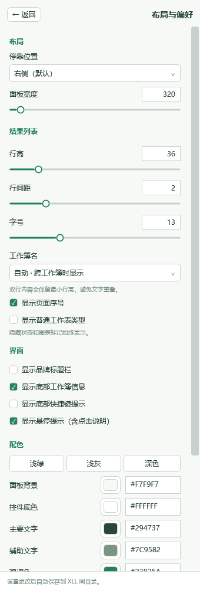
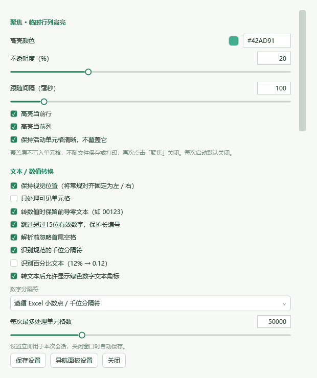

# GridPilot

面向 Windows 桌面 Excel 的便携工具集。原生 Ribbon 搭配 WPF 界面，提供原样复制、工作表导航、批量重命名、临时行列聚焦和文本 / 数值转换。原 SheetPilot 自 v0.4 更名为 **GridPilot**。

**当前版本：v0.7.0 正式 Release。** 目标为 Windows 10 + Excel 2010 标准版；已在 Excel 16.0 64 位完成原样复制集成测试，Excel 2010 和 x86 Excel 加载仍需目标机验收。逐项测试结果见 [验证记录](VALIDATION.txt)。

## 下载与使用

从 [Releases](https://github.com/ionize1080/GridPilot/releases) 下载 `GridPilot-0.7.0-portable.zip` 并解压。

1. 在 Excel 的“关于”页面确认 **Excel 位数**，不要按 Windows 位数选择。
2. 32 位 Excel 加载 `GridPilot-x86.xll`；64 位 Excel 加载 `GridPilot-x64.xll`。一次只加载一个。
3. 双击 XLL，或在 Excel 中通过“文件 → 打开”加载。
4. 点击“GridPilot → 工作表导航”。

无需安装本插件、VSTO、浏览器组件或管理员权限。系统需已有 .NET Framework 4.6.2+；Windows 10 1607 及之后的正常系统满足这一运行基线。`Check-Environment.ps1` 提供只读检查。

Excel-DNA 创建 Ribbon 和任务面板时会做当前用户的临时 COM 注册，所以便携不等同于完全不访问注册表。XLL 未进行发布者数字签名；加载仍受 Office 信任策略约束。

## v0.7 更新

- 新增 **原样复制·内部公式** 和 **原样复制·仅数值** 两个 Ribbon 按钮，输出到新建、未保存的工作簿，保持原单元格坐标。
- 内部公式版保留能明确确认引用均在复制范围内的普通 A1 公式；范围外、跨表、名称、数组及未知函数默认转为当前计算值，也可设为停止复制。仅数值版将全部公式固定为当前值。
- 共用“设置 → 原样复制”：范围、可见单元格、字体/填充/边框、数字格式、行高列宽、隐藏状态、合并、传统批注、视图、条件格式、公式处理策略与数量上限。
- 默认固定条件格式的当前颜色、字体和边框，移除规则；数据条和图标集需选择“仅基础格式”。表格转普通区域，清除名称、数据验证、超链接和外部工作簿链接。
- 批量读写和公式分块，按连续区间复制筛选后的排版；状态栏显示阶段，支持 Esc 取消，失败关闭未完成的结果。
- 本机合成样例 12 万单元格 / 2 万条公式约 0.9 秒（内部公式）与 0.6 秒（仅数值）；复杂条件格式和大量零散区域会更慢。详见 [原样复制说明](COPYING.txt)。


## v0.6 更新

- 聚焦不再因正常点击期间 Excel 短暂忙碌而隐藏；透明帧一次提交，相同高亮区域不重复重绘。
- 检测实际工作表遮挡，进入“文件”页面、右键菜单和设置窗口时隐藏，返回表格后恢复。
- 设置改为左侧六个分类、右侧连续滚动；点击定位与滚动位置联动。
- 通用配色、导航布局、聚焦、转换和重命名默认规则均可在统一设置内调整，保留导航独立入口。

## v0.5 更新

- 重命名窗口统一表头/单元格边距、垂直居中与分区卡片；强调新名称和主要操作。
- 色盘支持二维饱和度/明度、色相条、常用颜色与 HEX 手输；导航与工具设置共用。
- 聚焦改为 Excel 选区事件内立即更新；缓存可视边界，空闲时降低滚动检查频率。
- 跨工作簿时同步所有打开面板，活动项不再被旧选择覆盖；跳转到新窗口自动显示导航。
- 按宿主 DPI 换算导航宽度，解决高 DPI 下工具栏和结果被裁切的问题。

## 功能

- **原样复制**：内部公式版 / 仅数值版两个按钮；保留坐标、主题及可配置的单元格外观和行列布局，新工作簿不自动保存。完整边界见 [COPYING.txt](COPYING.txt)。
- **批量重命名**：当前 / 所有工作簿范围，逐项勾选、正则捕获替换、前后缀、大小写、编号、隐藏页 / 图表页过滤。应用前展示新旧名称，检测重名、非法名称、保护状态和过期预览；支持循环换名与撤销。
- **聚焦**：跟随活动单元格的临时透明行列覆盖层，可调颜色、不透明度、滚动补偿间隔及保留中心单元格。不会写入格式、条件格式或工作簿；目前用于普通工作表视图。
- **转为文本 / 数值**：只处理选择区域内的常量，支持不连续区域。默认将“常规对齐”固定为原来的左右视觉位置；保留显式对齐、缩进及其他格式。转文本使用底层数值，不把显示格式转成文字；日期数值会成为序列号文本。
- **转换保护**：默认跳过前导零和超过 15 位有效数字的文本；公式、合并单元格、锁定单元格等不转换。绿色角标由 Excel 自身的后台错误检查控制。
- **统一设置与撤销**：Ribbon 独立设置入口；最近一次成功的重命名 / 转换可用 GridPilot 的撤销按钮恢复。目标被再次编辑时拒绝覆盖，关闭 Excel 后不保留撤销记录，修改不自动保存工作簿。
- **自绘图标**：GDI+ 按像素尺寸绘制并由 Ribbon 加载，替代 Office 内置图标；实际 Excel 2010 高 DPI 清晰度仍需目标机验收。

- 范围切换：当前工作簿 / 同一 Excel 进程内所有已打开工作簿。
- 枚举工作表、图表页、隐藏页和 VeryHidden 页，保留原始顺序。
- Sheet 名称包含搜索、正则表达式、大小写与隐藏页选项。
- 单击或 Enter 跳转，方向键选择；面板内 Ctrl+F 搜索、Esc 清空、F5 刷新。
- 自动同步页面名称、顺序和活动状态；正则搜索具有取消和超时保护。
- 隐藏页仅显示和标注，不擅自取消隐藏或修改工作簿。
- 默认右侧停靠，可记住左右位置和宽度；行高、行间距、字号和显示选项可调。
- 当前工作簿范围默认省略重复文件名，跨工作簿自动显示；也可始终显示或隐藏。
- 数字设置支持滑块和键入；提示可关闭；浅绿/浅灰/深色及五项自定义颜色。
- 拖动宽度时延后记录且不反向写回，减少重复布局；原生拖动顺滑度仍需目标机确认。
- 默认移除大标题，保留紧凑工具栏；偏好设置随 XLL 文件夹携带。

这是 Sheet 页面目录；自定义书签树、单元格书签和跨会话收藏尚未实现。


图像来自实际 WPF 控件的离屏渲染，并非 Excel 2010 屏幕截图。v0.5 已在本机 Excel 16 x64、200% DPI 下完成点击、跨工作簿切换、色盘拖动和公开样例性能验证。

## 布局与偏好

点击右上角“设置”，修改立即生效，约 400ms 后自动写入 XLL 同目录的 `GridPilot.navigation.json`，退出时补存。数字输入用 Enter 或失焦提交，Esc 撤销；无效内容保留原值。支持停靠位置、宽度、行高、行间距、字号、序号、页面类型、品牌标题栏、底部信息、快捷键提示和刷新开关/间隔，以及悬停提示和配色。范围、正则、大小写、隐藏页也会保存，搜索词不保存。

配置采用同目录原子替换，保留 `.bak`；只读目录会明确提示仅本次有效，不自动写到其他目录。未知配置版本不会被覆盖。独立 Excel 进程之间以最后保存者为准，不做实时同步。

统一工具设置存为 `GridPilot.tools.json`。升级后若没有新导航配置，会从同目录旧 `SheetPilot.settings.json` 复制偏好；旧文件保留。升级前取消旧 XLL 的自动加载，避免新旧版本同时运行。

左右拖动停靠和调整宽度也会记录；浮动/上下停靠不作为重启位置保存。升级请退出 Excel 后替换 XLL，并保留配置文件。详见 [设置说明](SETTINGS.txt)。






## 架构与扩展

| 项目 | 职责 |
| --- | --- |
| `SheetPilot.Core` | 不依赖 Office 的数据模型、搜索、模块与命令合同 |
| `SheetPilot.UI` | WPF 导航视图和视图模型 |
| `SheetPilot.Excel` | Excel-DNA、Ribbon、COM 适配和面板生命周期 |
| `SheetPilot.Tests` | 基础测试、WPF 渲染和可选 Excel 集成测试 |

新功能实现 `IFeatureModule`，提供命令并在组合根注册，Ribbon 自动生成分组和入口。UI 不持有 Office COM 对象；后台任务只处理脱离 Excel 的快照。

采用 Excel-DNA 1.9.0 + .NET Framework 4.6.2 + WPF/ElementHost。不使用 VBA、WebView、WebView2、Electron 或窗口父子关系修改。

详细决策、边界与后续路线见 [ARCHITECTURE.txt](ARCHITECTURE.txt)。

## 构建与验证

开发机需要 Windows 和 .NET SDK 8/9。终端用户不需要 SDK。

```powershell
powershell -NoProfile -File .\build.ps1
```

脚本使用依赖锁文件，构建双位数 XLL、运行基础测试并输出 `dist/`。构建与基础测试不要求安装 Excel。

测试包括纯逻辑、WPF 渲染及 Excel 16 实际 COM / XLL 加载。覆盖重名和过期预览、跨工作簿操作、常量转换与对齐恢复、覆盖层不修改工作簿、导航停靠与退出。具体结果见 VALIDATION.txt；这些测试不能代替旧版 Excel 验收。

**Windows 10 + Excel 2010 标准版的任务栏文件切换、退出、停靠和 x86 加载尚未验收。** 未据新版 Excel 的测试结果保证旧版兼容性。

- [详细构建说明](BUILD.txt)
- [测试记录与目标机验收清单](VALIDATION.txt)
- [使用说明](README.txt)
- [第三方组件说明](THIRD-PARTY-NOTICES.txt)

## 发布内容

Release 提供完整便携包、独立 x86/x64 XLL 与 SHA-256 校验文件。源码由 Git 标签固定。升级时先退出 Excel，再替换文件。
