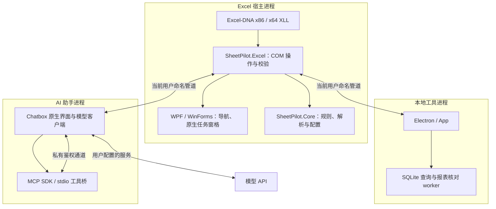
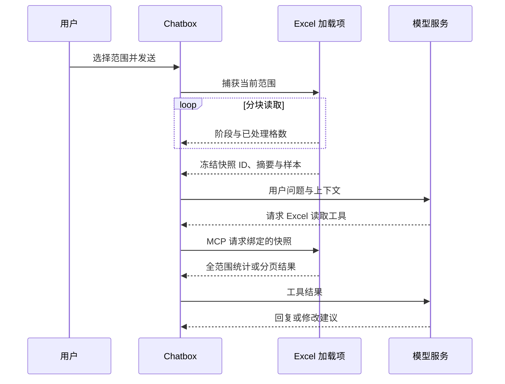

# 架构与数据流

[文档首页](../README.md) · 适用 v1.9.1 · 2026-10-21

GridPilot 由 Excel 内的 .NET 加载项、本地工具界面和独立的 Chatbox AI 工作区组成。Excel 对象访问回到宿主主线程，界面与计算按边界分离。产品名为 GridPilot，程序集和命名空间保留 `SheetPilot.*` 以维持既有入口兼容。

## 组件总览

本地 `App/` 与 AI 的 Chatbox 是不同的信任边界。本地工具限制远程导航和网络；AI 使用原生提供方客户端连接用户配置的服务，不能把整个产品描述为“完全不联网”。

## 目录与职责

| 路径 | 职责 |
| --- | --- |
| `src/SheetPilot.Core/` | 排序、重命名、数值转换、脱敏与公式规则、配置模型 |
| `src/SheetPilot.UI/` | WPF 导航、颜色与输入控件、部分原生窗口 |
| `src/SheetPilot.Excel/` | Ribbon、Excel 生命周期、COM 读写、上下文、批量应用与恢复 |
| `App/` | 设置、排序、脱敏、数据库与核对等本地界面；worker 计算 |
| `integrations/chatbox/` | 固定上游准备、bootstrap、preload、MCP schema 和 stdio 桥 |
| `Resources/`（发布目录） | 固定离线词典与 HMM 资源 |
| `tests/` | 逻辑、原生宿主、Excel 集成、浏览器、真实 API 与泄漏扫描 |
| `docs/` | 当前指南、历史记录、界面截图与许可 |

[build.ps1](../../build.ps1) 将 packed XLL 命名为 `GridPilot-x86.xll` 和 `GridPilot-x64.xll`，连同 DLL、App、Browser、Resources、Chatbox 一起分发。不能只部署 XLL。

## Excel 主线程与生命周期

Excel COM 不作为后台线程的通用数据结构使用。宿主操作由 [ExcelGateway.cs](../../src/SheetPilot.Excel/ExcelGateway.cs)、各业务 Operations 类及 [PortableWindow.cs](../../src/SheetPilot.Excel/PortableWindow.cs) 调度回 Excel 宏上下文。耗时读取按块进行并让出主线程，统计等可在冻结数据上后台完成。

界面通过随机命名、当前用户 ACL 的管道交换消息，生产模式不监听调试 TCP 端口。请求标识关联响应；进度与取消独立传递。进程退出释放对应桥和上下文。测试用 CDP 仅在隔离运行目录临时加入。

导航使用 Office 原生任务窗格内的 WinForms/WPF 控件；聚焦是只读、鼠标穿透的覆盖层，不修改工作表格式或打印结果。工作簿身份按实际对象绑定，不能用文件名替代。

## AI 上下文与读取

[AiOperations.cs](../../src/SheetPilot.Excel/AiOperations.cs) 捕获选区、工作表或可见工作表集合，隐藏行列不自动排除。稀疏区域按块读取，使用 64 位计数；不以固定 200,000 格截断上下文。大范围仍受内存、Excel 调用耗时和宿主位数限制。

冻结数据采用临时文件存储，正常释放时删除。普通上下文最多保留最近 8 份；恢复点仍需要的快照会固定保留。读取期间监听编辑变化并拒绝不一致捕获，但依赖 Excel 事件开启，不能保证外部代码关闭事件后仍可检测全部变化。

初始上下文包含最多 120 个样例单元格；`excel_read` 每页最多 200 个非空单元格，`excel_find` 与 `excel_statistics` 基于全部捕获范围。上下文前缀将单元格标为数据，并给出短公式示例。工具 schema 再声明前导等号、二维形状和版本兼容要求。

## 建议、批准与恢复

| 层次 | 实现 | 核心约束 |
| --- | --- | --- |
| 工具与参数 | `tools.cjs`、`AiRange.cs` | 10 项工具、有限 schema、明确范围、公式能力与危险函数限制 |
| 建议合并 | `AiBatch.cs` | 按后端生成顺序合并内容及格式属性，保留非重叠部分，清理过期项 |
| 批准 | `AiCheckpoints.cs` | 默认关闭；用户选择当前对话或实际工作簿对象；AI 无授权工具 |
| 应用 | `AiBatch.cs`、`AiPivot.cs` | 写前整批校验，目标冲突即停止，写入／保存失败尝试本批回滚 |
| 恢复 | `AiCheckpoints.cs` | 完整文件副本 + 最新检查点变更记录；前后切换前再次验证 |

手工应用与自动批准共用校验和备份路径。首次写入／新周期先 `SaveCopyAs`，成功写入后保存完整变更后副本，再报告成功。连续内容修改可合并恢复点；前状态继续写入、重复格式、目标手工变化或切换工作簿会开始新点。

UI 恢复记录按对象、工作表和地址记录 AI 触及内容，保存公式及 `HasFormula` 类型；格式原区域必须一致。图表保存创建参数与对象状态；透视表使用原生 `PivotCaches.Create` / `CreatePivotTable`，输出到新工作表，检查内容和常用格式／对象指纹，结果限 100,000 格。保护、隐藏表、合并、数组、溢出及表格等不支持目标拒绝写入。

完整文件备份保留在本地 Recovery 目录；内存记录只覆盖最新恢复点，重启助手后不能直接重放。冲突检查不涵盖全部 Excel 元数据，回滚本身也可能失败，须保留错误与备份路径，不能承诺绝对无损。[用户可见恢复规则](../guides/AI.md#批准与恢复)

工作簿级批准跨会话、恢复和失败保留；关闭工作簿或助手后清除。对话级批准在换会话、成功恢复或应用失败后清除。切换活动工作簿不会把授权复制给其他对象。

## 侧栏与独立窗口

[AiWorkspace.cs](../../src/SheetPilot.Excel/AiWorkspace.cs) 用原生任务窗格提供占位矩形，Chatbox Chromium 保持 **Excel 所有的顶层窗口**，不用 `SetParent` / `WS_CHILD`，避免宿主抢走编辑输入。

侧栏移除 window/client/dialog edge，关闭 DWM 非客户区绘制与阴影；约 120ms 跟随宿主位置和可见性。前端只隐藏重复窗口控制，保留 Office 原生关闭按钮。独立模式恢复窗口样式与边界。

模式请求串行进入 Excel 宏上下文；优先复用隐藏窗格，在工作簿窗口变化或窗格失效时重建。最大化／最小化窗口先还原，再停靠；防止快速重复点击和旧句柄复用。已验证场景与旧版宿主缺口见 [验证总览](../validation/README.md)。

## 本地数据工具

- **排序与复制**：规则和预览在 Core／界面组织，最终通过 Excel 原生区域操作；保留表头、合并块和已有内容校验。原样复制创建新工作簿，公式不确定时按设置转值或停止。
- **智能脱敏**：主线程读取源，私有 Excel STA 对结果重算、验证和重新打开；源数据不写回，输出独立 XLSX。公式支持集有限，不能用缓存冒充已验证公式关系。
- **简易脱敏**：选区预览；导出新文件或明确确认后写回，写前逐格检查；恢复 JSON 只有主动导出才持久化。
- **报表数据库**：保存的 OOXML 缓存 → 字段与组合键校验 → SQLite 事务；代表记录和来源贡献分开存储。只读查询在独立子进程，配合只读连接、query_only、authorizer、超时和取消。
- **监管核对**：来源／规则／期间 → 归集与差异 → 明细追溯／报告草稿；缺失或错误保留为异常／部分结果，不能自动补成业务原因。

## 配置、依赖与维护

通用偏好在 XLL 同目录的 JSON，原子写入并保留 `.bak`；未知新 schema 不覆盖。聊天配置、数据库、恢复副本分别存于用户目录，详见 [存储表](../guides/DATA-AND-STORAGE.md)。

固定依赖包括 .NET Framework 4.6.2 目标、Excel-DNA 1.9.0、Electron 44.7.0、Chatbox 1.20.3、MCP SDK 1.32.1；来源、hash 和许可见准备脚本、锁文件和 [第三方说明](../licenses/THIRD-PARTY-NOTICES.txt)。Chatbox 准备过程校验安装包／asar 并提取，保留源码映射与补丁溯源；原生模型认证和工具循环保持上游路径。

修改功能时同步当前指南和专项测试；发布记录只写已经执行的验证。历史架构不再作为当前实现说明。后续入口：[构建与测试](BUILD.md) · [界面规范](UI.md) · [MCP 速查](MCP.md)
