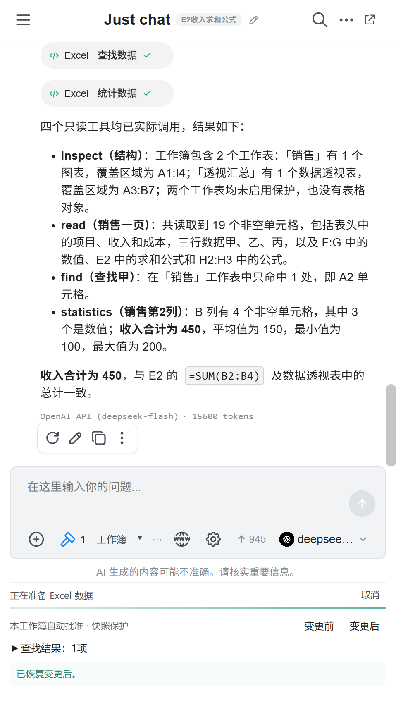

# 界面与交互规范

[文档首页](../README.md) · 适用 v1.9.1 · 2026-10-21

GridPilot 的界面以工作表内容为中心：常用操作直接可见，解释与高级选项按需展开。Office 原生标题与边框归 Office 管理，插件的窗口、菜单和图标保持简洁一致。

## 窗口与菜单

| 场景 | 行为 |
| --- | --- |
| AI 侧栏 | 使用原生任务窗格，隐藏 Chatbox 内重复的最小化／最大化／关闭，只保留模式切换小按钮 |
| AI 独立窗口 | 保留正常窗口控制，并提供返回侧栏入口 |
| 工具菜单 | 操作后、外部点击、输入框聚焦、Esc 收起 |
| 模式转换／应用中 | 暂时禁用相应操作，显示明确处理中状态，避免重复提交 |
| 下拉选择 | 当前值与选择状态清楚，菜单边界轻量；键盘、焦点和窄窗口可用 |
| 待应用建议 | 默认紧凑摘要，可展开检查，支持单项丢弃与清空 |
| 快照 | 仅有有效恢复点时展示变更前／后入口，错误反馈靠近操作 |

颜色与文字须共同传达状态，不只靠颜色区分。应用按钮采用不透明深绿底与白字；失败保留可读原因，成功反馈后移除已处理建议。

## 进度

本地上下文捕获显示阶段与已处理格数，未知总量用不定长细条，不捏造上传百分比。用户可以取消；单次 COM 调用返回后才响应是执行边界，界面文案不能承诺即时中断。

## 图标

Ribbon 功能图标统一 32 单位画布、圆角笔触、透明背景与 1.65 单位线宽，以较高分辨率绘制后缩小；支持 96–288 DPI 和青瓷、晴蓝、石墨配色。复制公式／数值采用 fx／123，文本／数值用 A／12，功能轮廓可区分。

AI 图标由项目代码绘制；不复制第三方 AI 品牌图案。实现入口为 [RibbonIcons.cs](../../src/SheetPilot.Excel/RibbonIcons.cs)。

## 导航与输入

导航单击／Space 跳转，双击／F2 改名，Enter／失焦提交，Esc 取消，Insert 新建，Alt+上／下移动。编辑框右键支持标准文字操作，菜单关闭后继续编辑。不要覆盖 Excel 的全局 Ctrl+B 等常用快捷键。

数字设置支持滑块和输入，超出范围限制到边界，无效内容不覆盖旧值。导航设置的颜色即时反馈；原生宿主色盘拥有明确 owner，避免依赖另一个窗口的消息循环。

## 图片与验证约定

文档图片只用合成测试数据；界面截图注明版本，架构流程用 Mermaid 描述真实流程。验证覆盖窄窗口、中文输入、菜单关闭、明确焦点与实际窗口切换；浏览器 DOM 测试不能替代 Excel 宿主验收。

[使用指南](../guides/AI.md) · [原生窗口验证](../validation/README.md)
