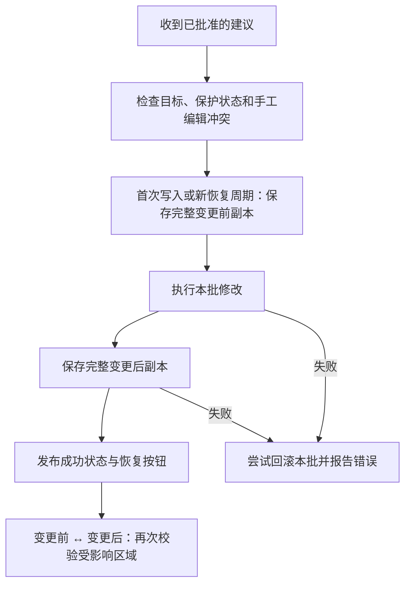

# AI 助手：从提问到可恢复的修改

[文档首页](../README.md) · 适用 v1.9.1 · 2026-10-21

AI 助手基于固定版本的 Chatbox 集成。它通过 Excel MCP 工具读取上下文、准备修改建议，并由用户手动批准或明确开启的自动批准执行。模型不能自行打开自动批准，也没有直接执行 VBA 或任意命令的工具。

## 选择范围，再提问

| 范围 | 什么时候用 | 需要知道 |
| --- | --- | --- |
| 选区 | 针对几个字段或一个区域 | 默认选择；确认当前选区包含问题所需数据 |
| 工作表 | 分析当前表、生成汇总 | 按开始读取时的工作表对象绑定 |
| 工作簿 | 跨表分析 | 捕获可见工作表；隐藏行列中的单元格仍可能包含在上下文中 |
| 不附加 | 普通对话、只处理主动添加的附件 | 不生成新的 Excel 上下文；已有对话数据仍在历史里 |

每次发送前准备新的冻结上下文。模型先收到摘要与最多 120 个样例单元格，需要更多数据时通过工具分页读取；全范围统计由本地工具完成，不能把样本合计当成整表合计。更改源数据后重新发送问题，让模型使用最新上下文。

*范围菜单，v1.9.1 合成测试截图。*

大范围读取时会显示细进度条、阶段和已处理格数，可取消。总量未知时使用不定长动画，不显示假百分比。这是 **本地上下文准备进度**；后续网络请求及模型回复状态由 Chatbox 管理，目前没有网络字节级上传百分比。单次 Excel 原生调用仍需返回后才能响应取消。

## 可以让 AI 做什么

| 类别 | 工具 | 示例请求 |
| --- | --- | --- |
| 读数据 | `excel_read` | 读取这张表后面的记录，列出来源地址 |
| 找数据 | `excel_find` | 找出收入大于 100 的记录 |
| 统计 | `excel_statistics` | 对全部已捕获收入求和，不要只统计样本 |
| 看结构 | `excel_inspect` | 查看工作表、表格范围、图表数量和保护状态 |
| 单格公式 | `excel_propose_formula` | 在 E2 写入 B2:B4 的求和公式 |
| 批量值 | `excel_propose_values` | 在 F1:G4 填入这组二维数据 |
| 批量公式 | `excel_propose_formulas` | 在 D2:D21 写入收入减成本公式 |
| 格式 | `excel_propose_format` | 将利润率列设为百分比并加粗标题 |
| 图表 | `excel_propose_chart` | 以 A1:C4 创建原生柱形图 |
| 透视表 | `excel_propose_pivot` | 新建“项目汇总”表，按项目汇总收入 |

图表支持柱形、条形、折线、饼图、散点和面积图。透视表使用 Excel 原生对象，目标必须是新工作表，源首行标题须非空且唯一；支持行、列字段与求和、计数、平均、最小、最大汇总，输出上限 100,000 格。

公式必须以 **`=` 开头**，使用英文函数名和逗号，例如 `=SUM(B2:B4)`。将 `=SUM(B2:B4)` 交给“写值”工具会保留为文字；需要计算时用公式工具。Excel 2010 没有 XLOOKUP、FILTER、LET 等新函数，应使用宿主支持的函数。这些要求已经写入工具描述和简短上下文提示；参数示例见 [MCP 速查](../development/MCP.md)。

## 手动应用与积累建议

自动批准关闭时，写入类工具只生成建议。展开「待应用建议」检查工作表、范围与内容，再点击「一键应用」。可以丢弃单项或清空待应用列表，后台同步删除相应建议。

多条建议覆盖同一单元格时，**后生成的内容建议优先**；格式按属性合并，例如最新字体颜色不会清掉先前加粗。仍保留非重叠部分，过期建议会清理。目标被手工修改属于冲突，会阻止整批写入，不能通过“较新的建议优先”绕过。

应用过程中按钮显示“正在应用并保存快照…”，完成后展示结果并移除已处理项。聊天中的“已完成”不代表实际成功，应以工具结果和工作簿为准。

## 批准与恢复

自动批准默认关闭。打开 Excel 工具菜单，选择范围并开启：

| 选项 | 有效期 |
| --- | --- |
| 本工作簿 · 多轮对话有效 | 同一打开的工作簿，在多轮对话、会话切换、恢复前后切换和操作失败后仍保留授权 |
| 仅本次对话 | 当前对话；换会话、成功恢复或应用失败后撤销 |
| 关闭开关 | 后续写入重新等待手动批准 |

授权只保留在当前助手实例的内存中，绑定实际工作簿对象，关闭工作簿或助手后失效。切到另一工作簿不会继承；切回仍打开的原工作簿可继续原授权。同名新文件也不会继承。

### 两种恢复路径

| 恢复路径 | 用途 | 有效范围 |
| --- | --- | --- |
| 「变更前／变更后」按钮 | 快速比较并切换最新恢复点 | 助手仍运行时，恢复 AI 触及的内容、格式和新建对象；保留无关单元格编辑 |
| 「打开完整备份」 | 关闭助手后恢复，或处理无法自动恢复的冲突 | 打开本地 Excel 副本，核对后另存或人工恢复 |

连续内容修改可合并为同一恢复周期，保留最初的变更前状态与最新变更后状态。若从“变更前”继续写入、先前 AI 目标被手工修改、重复修改格式或更换工作簿，会建立新恢复点；旧完整副本继续保留，界面只切换最新恢复点。

完整副本位于 `%LOCALAPPDATA%\GridPilot\Recovery`，支持 xlsx、xlsm、xlsb、xls；其他格式需先另存为支持格式。备份包含尚未保存的工作簿数据，不会自动上传，也不自动删除。备份保存失败会阻止写入或触发本批回滚；若回滚也失败，错误会指向完整备份。

### 恢复的边界

- 目标必须仍是原工作簿、工作表和所记录的内容／公式类型。相关目标被手工编辑时拒绝覆盖。
- 受保护、隐藏工作表、合并、数组／溢出、Excel 表格等不支持的写入目标会被拒绝。
- 格式建议要求原格式在范围内一致，避免把混合样式强行压平；重叠格式拆分每项最多 100,000 格。
- 图表／透视表恢复会检查相关对象和生成工作表。检查覆盖常用内容、格式和对象状态，无法覆盖任意命名区域、打印设置、宏副作用等所有 Excel 元数据。
- 最新恢复点不是永久历史列表，也不是完整工作簿任意状态的一键切换。关闭助手后用完整副本恢复，另存前先确认文件内容。

## 侧栏与独立窗口

标题栏的小按钮可在两种模式间切换，也可从 Excel 工具菜单切换。侧栏保留 Office 原生窗格关闭按钮，隐藏内部重复的最小化、最大化和关闭按钮；独立窗口保留正常窗口控制。

v1.9.1 修复重复切换、跨工作簿和最大化状态下的转换；转换期间按钮暂时禁用以防重复请求。工具菜单在操作、外部点击、聚焦输入框或 Esc 后关闭。

## 数据、错误与测试

上下文样本、工具结果和主动附件会送往配置的服务。完整 Recovery 副本不自动附加；选择“不附加”也不会清空聊天历史。[数据与存储](DATA-AND-STORAGE.md) 说明各目录及清理方式。

遇到公式没有建议、快照过期、批量应用失败或模式切换异常，先看 [故障排查](TROUBLESHOOTING.md)。[验证总览](../validation/README.md) 列出真实 API、10 项工具、原生窗口和恢复测试的证据与平台限制。
