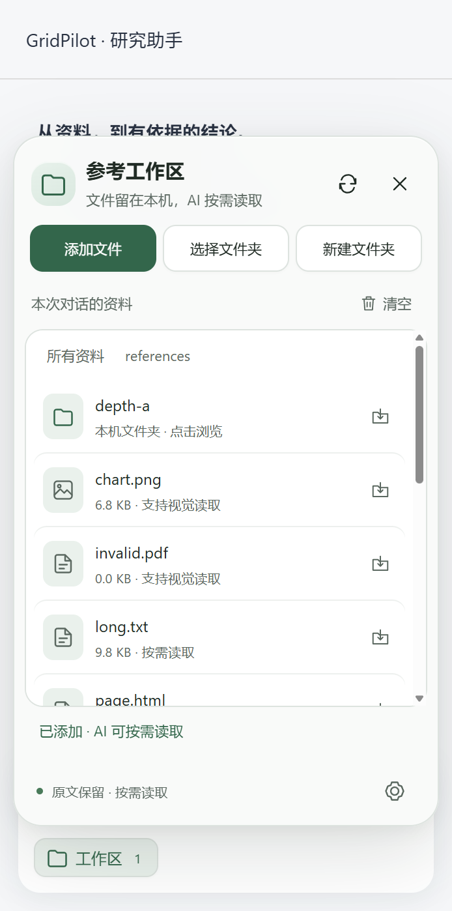

# 参考工作区

适用 v2.2.0 · 2026-11-17

在 AI 输入栏点击 **工作区**，添加本机文件、选择文件夹，或拖入资料。支持虚拟文件夹、嵌套、重命名、多选和拖放排序，整理的是引用，原文件位置不变。每个聊天独立保存，第一次发送与重新打开聊天都保留同一工作区。

## 清空与撤销

点击资料栏 **清空** 即刻清空当前工作区引用和虚拟文件夹，源文件及已生成的底稿文件均保留。旁边会出现 **撤销清空**，可恢复清空前的工作区；清空后新增的资料也会保留。撤销记录在重启后仍可用，支持最近一次有内容的清空。空工作区重复点击清空不会丢失撤销记录。

清空后，AI 无法继续用旧工作区 ID 读取资料；已进入历史对话的内容不会因此删除。撤销后下一次发送使用恢复的工作区。

## AI 如何读取

AI 先看目录和结构，再用分页读取、查找、批量片段或图片工具按需读取。初始目录和片段预览不等于完整文档。长 Excel 单元格不会在 4,000 字处截断，可按返回的下一段位置读到末尾。单文件默认上限 100 MB，可在工作区首选项中调整为 1–1024 MB；解析时间、格式和模型上下文仍有限制。

- 扫描 PDF、图片、图表需要支持视觉的模型；不宣称自动 OCR。
- XLSX/XLSM 可读单元格、公式和缓存值，包含隐藏表；读取不自动重算。XLS/XLSB 读取缓存值，XLSB 不提供公式文本。
- Word、PowerPoint 的文本、表格、备注和内嵌图片可按结构读取，复杂版式请导出 PDF 后查看。
- 邮件与 MHTML 返回正文及附件目录；附件须单独保存并添加才能读取。不会执行代码、宏、脚本或外部链接。
- 损坏、加密和不支持的专有格式明确报错；不会把无法读取的内容当成空文件。

## Excel 分析底稿

参考表可生成带来源、数据、计算和结果的 XLSX 底稿。工作区中打开“分析底稿”文件夹，点击 **在 Excel 中打开**，底稿直接在当前 Excel 实例打开，原工作簿和未保存编辑保留。之后可使用已有 GridPilot 工具继续编辑；原工作簿的自动批准不会转移到新底稿。

离线分析适合计算、筛选、分组与静态透视。需要原生可刷新透视表或 Excel 计算时，可生成独立后台 Excel 副本。对当前工作簿的修改仍走原有批准与快照机制。源文件不被覆盖，底稿可单独导出或删除；工作区清空不会删除磁盘文件。

## 文件类型

支持 **95 种扩展名**，覆盖 Office 文档及模板、XLSB、OpenDocument、PDF、EPUB、邮件/MHTML、常见图片、文本数据与代码。扩展名支持不代表所有专有内部对象都能解释。图片与扫描件采用视觉读取，代码文件只按文本读取。

完整列表见 [格式目录](../v2.2/FORMATS.md)，AI 可调用 `workspace_info` 获取实际支持格式、读取方式和限制。

[测试与已知边界](../v2.2/VALIDATION.md) · [数据保存位置](DATA-AND-STORAGE.md) · [MCP 工具](../development/MCP.md)
