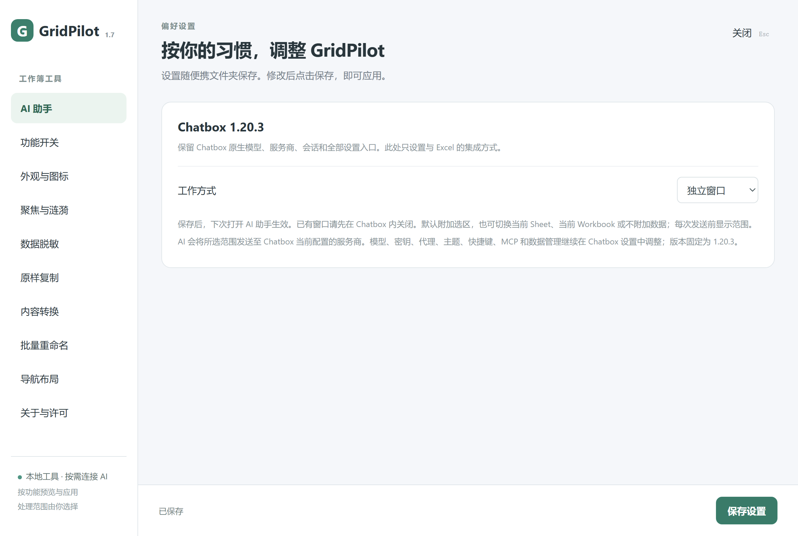
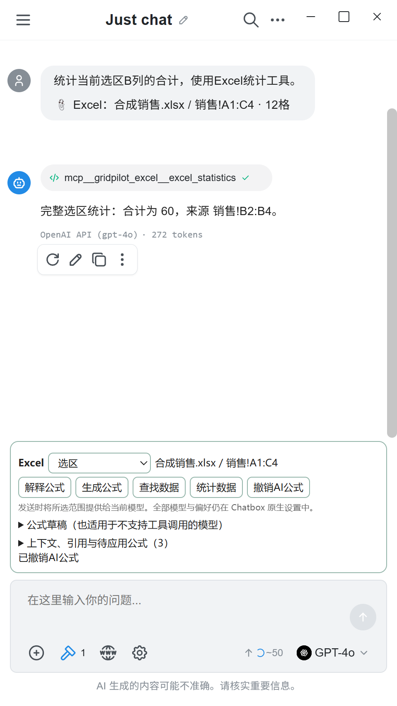
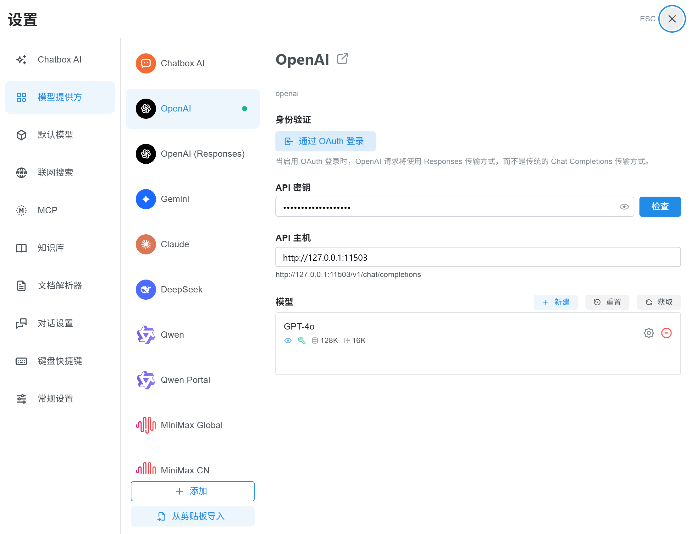

# v1.7.0 验证记录

日期：2026-10-20。环境：Windows 11、Excel 16 x64、.NET Framework 4.6.2 目标、Electron 44.7.0、官方 Chatbox 1.20.3。全部工作簿、模型响应和密钥字段均使用合成测试数据；未读取或改写用户现有工作簿、会话和模型配置。

## 构建与回归

`build.ps1 -PackageSource .temp/packages` 成功，生成 x86/x64 XLL。基础 265、发布功能 52、升级 27、v1 169、v1.1 97、多级排序 5、AI 基础 9 项断言通过，另含原生菜单、颜色选择器和 Electron Node 回归。现有导航测试第一次受前台菜单焦点影响失败，独立重跑完整构建通过。

`tests/ai-tools.cjs` 验证 MCP 只有读取、查找、统计和提议四种工具，没有写入/撤销工具；验证 snapshotId、参数白名单、防止 action 参数覆盖、错误返回与提议通知。

## 实际 Excel

`SheetPilot.Tests.exe --ai --excel`：**24 项通过**。覆盖选区与公式读取、完整列统计、数值查找与地址、建议不写入、切换工作簿后仍写原目标、撤销空白、目标修改后拒绝覆盖、隐藏表排除、等号开头文本、Excel 错误值排除、200,000 格上限、关闭工作簿失效、快照先进先出及最新8份保留。

`SheetPilot.Tests.exe --ai-host <隔离目录/GridPilot-x64.xll> 0` 和 `1`：**每种模式 4 项通过**。真实 Excel 注册 XLL、原生 Chatbox 侧栏/独立窗口、Windows 子窗口样式、重复打开激活、关闭进程并清理连接。独立模式测试等待实际 Chatbox 标题，避免把 Electron 短暂的无标题启动窗口当成目标。

## 原生界面与完整工具往返

`node tests/browser-ai.cjs` 使用真实发行版 UI、独立临时配置与本地模拟 OpenAI 兼容服务，验证：

- 原生 electronAPI 和 Excel preload 同时存在，中文界面及原生模型选择正常。
- 选区/Workbook 上下文、不附加数据、摘要显示与模型专用快照展开。
- 原生 MCP 配置存在、未带令牌请求返回401、固定版本关闭自动更新。
- 模型提议公式后保持未写入，点击应用才请求写入，撤销入口可用。
- 在原生输入框发送问题，模型请求包含快照；原生 MCP 统计工具返回后产生第二次模型请求和最终回答。
- 480 DIP 窄侧栏无上下文控件横向溢出，原生会话抽屉收起且保留开关，原生设置可打开。

自动化曾在调试器接入与 Electron ready 之间发生竞争；显式加载 Playwright ready 同步器后连续三次通过，最终连接层版本再次通过。所有截图在原生界面中生成，没有替代 Chatbox 界面。

`node tests/browser-v1.cjs` 验证 GridPilot 模式默认侧栏、切换独立窗口及保存、原有功能开关/重复保存/脱敏预览和取消保存流程。

## 包与限制

完整包和清洁包均包含固定 Chatbox 程序、GPL 许可、原生依赖许可/source map 及 `provenance.json` 的五处补丁散列。打包程序检查 ZIP CRC、双位数 XLL、浏览器运行时、许可及 Chatbox 来源记录，并生成 SHA-256 校验文件。

没有使用真实付费云模型评测回答正确率；本地模拟链路验证的是协议、上下文和工具执行。Win10、Excel 2010 和 32 位 Excel 尚未实机验证。200,000格以上范围、隐藏工作表读取、批量写入、表格计算列、动态数组及结构化引用不在本版支持范围；原生账号/OAuth/云同步等在线功能未逐项做端到端验证。

