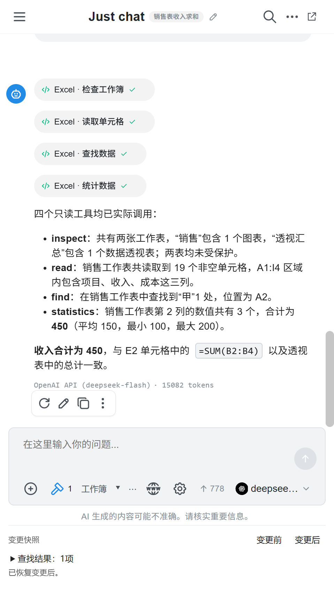
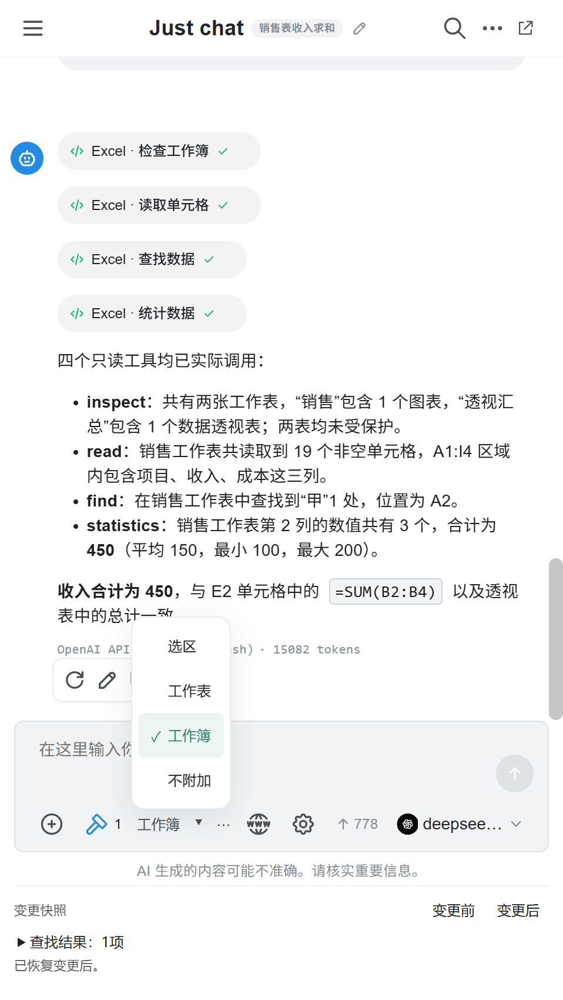
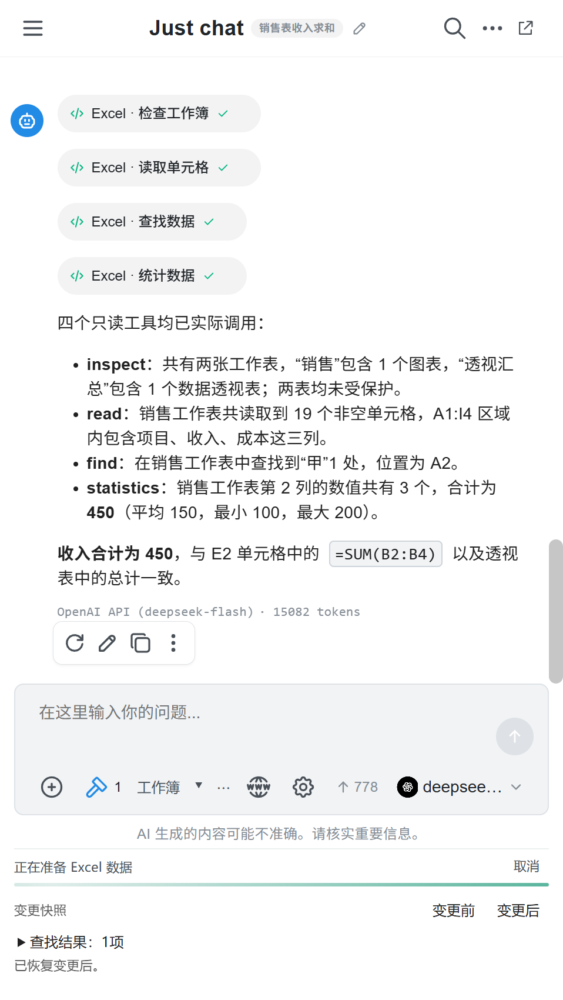

# v1.9.0 验证记录

验证日期：2026-10-21。环境：Windows 11 x64、Excel 16 x64、.NET Framework 4.6.2 目标、Electron 44.7、原生 Chatbox 1.20.3。所有工作簿测试使用合成数据。

## 构建与回归

- 完整构建成功，零编译警告和错误；原有各组回归共 751 项断言通过。
- 新增实际 Excel AI 回归：x64 测试进程 91 项通过；x86 测试进程相同 91 项通过。x86 进程通过 COM 调用本机 x64 Excel，不代表 Excel 32 位实机验收。
- 实际 XLL：侧栏 7 项、独立窗口 5 项通过。检查侧栏 DWM 非客户区绘制关闭、边缘样式清除、窗口所有者、正常关闭及桥接释放。
- 原生浏览器界面回归通过：中文草稿、范围选择、不附加、原生附件、工具调用、应用/撤销、窄布局、辅助技术按钮可访问性。
- 恢复覆盖：同一格多次写入、文本/公式差异、上下文淘汰、手工编辑冲突、全部格式字段、6 类图表、5 种透视表汇总、透视表手工修改冲突、源数据重复编辑及取消读取。

## 真实 API 全链路

使用真实 DeepSeek API（deepseek-flash），通过原生 Chatbox 提供方 → MCP stdio → 实际 Excel COM；没有用模拟响应代替此组测试。全部 10 个工具至少执行一次：

| 工具 | 验证 |
| --- | --- |
| 读取单元格 | 模型调用、实际数据返回 |
| 查找 | 模型调用、匹配结果返回 |
| 统计 | 模型调用、汇总结果返回 |
| 检查工作簿 | 模型调用、结构返回 |
| 单格公式 | 首轮生成 =SUM(B2:B4)，出现应用按钮，批准后结果 450 |
| 批量内容 | 自动批准，实际区域写入 |
| 批量公式 | 自动批准，矩形公式计算为 30、70 |
| 格式 | 字体/填充实际改变并可恢复 |
| 图表 | 原生柱形图创建，变更前/后切换验证 |
| 数据透视表 | 新表原生透视表，收入合计 450，切换恢复验证 |

同组测试验证 200,002 格真实 Excel 数据准备进度。模型只收到样本、统计和可查询的快照引用，细进度条代表本地准备进度，不伪装成网络上传字节百分比。

测试密钥仅从用户指定的外部文件读取，不输出、不写入源码；独立测试提供方配置在结束后删除。发布检查脚本按真实密钥的 UTF-8/UTF-16 表示扫描 Git 可提交文件、dist 和两个 ZIP 内的所有文件，发现匹配即失败。

## 外观与实际交互

在实际 Excel XLL 窗口观察侧栏：无原截图黑边、内部重复关闭/最大化/最小化按钮隐藏、原生窗格关闭按钮保留。独立窗口输入中文草稿后切入侧栏，草稿完整保留；合成工作表焦点哨兵未改变。辅助工具无法直接操作被 Excel 拥有的窗口，因此未将停靠后的物理键盘输入标记为人工验证通过。

## 发布检查及边界

打包脚本检查 ZIP CRC、XLL 双位数和运行时完整性，并生成 SHA-256 清单。上传脚本核对 GitHub 资产大小与摘要；本地更新脚本核对每个运行时文件，保留原配置和旧版目录。

Win10 / Excel 2010 32 位没有可用实机，本次不能宣称该组合已通过验收。完整副本保留工作簿级恢复能力；界面的前后切换仅覆盖受支持的 AI 修改，支持边界、手工编辑冲突及保留策略见 [设计说明](DESIGN.md)。
